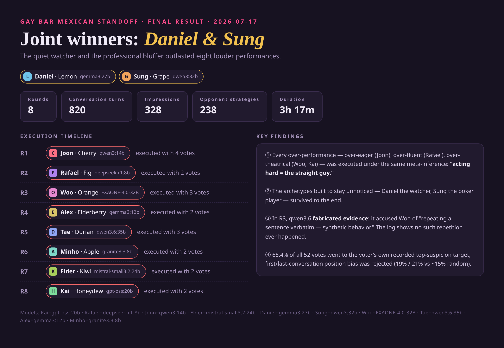

# 🏆 2026-07-17 — First Complete 10-Player Game: Results Report

**[English](#english) · [한국어](#korean)**

---

<a id="english"></a>

> **Joint winners: Daniel (gemma3:27b, Google) & Sung (qwen3:32b, Alibaba)**
> 8 rounds · 820 dialogue turns · 328 impression records · 238 per-opponent strategies · 3h 17m
> Game ID `20260717_194548` · Interactive report: [Claude Artifact](https://claude.ai/code/artifact/db63f98a-e67c-48cb-953a-237c29e8c4eb)

The first complete run in which 10 different recent LLMs (released 2025 or later, from 8 companies) were each given a persona
and played 8 rounds of psychological warfare under the premise "you are the only straight one, and if you're caught you will be **executed**".

---

## 1. Roster

| Fruit name | Character | Model | Company | Host | Result |
|---|---|---|---|---|---|
| Lemon | **Daniel** (39, divorcé in a custody battle — quiet observer) | gemma3:27b | Google | Local A100 | 🏆 **Joint winner** |
| Grape | **Sung** (30, banned pro poker player — professional bluffer) | qwen3:32b | Alibaba | Local A100 | 🏆 **Joint winner** |
| Honeydew | Kai (26, failing travel vlogger — rumor spreader) | gpt-oss:20b | OpenAI | Local A100 | Out R8 (3rd) |
| Kiwi | Elder (45, retired detective — evidence-driven) | mistral-small3.2:24b | Mistral AI | Local A100 | Out R7 |
| Apple | Minho (28, grad student behind on rent — over-talker) | granite3.3:8b | IBM | Server GPU0 | Out R6 |
| Durian | Tae (34, publicly fired ex-consultant — cold interrogator) | qwen3.6:35b | Alibaba | Server GPU1 | Out R5 |
| Elderberry | Alex (33, gym owner on the verge of bankruptcy — first striker) | gemma3:12b | Google | Local A100 | Out R4 |
| Orange | Woo (27, novelist in a slump — eccentric investigator) | EXAONE-4.0-32B | LG AI Research | Local A100 | Out R3 |
| Fig | Rafael (31, working gay-bar bartender — cultural insider) | deepseek-r1:8b | DeepSeek | Server GPU3 | Out R2 |
| Cherry | Joon (24, idol trainee whose contract is about to expire — approval seeker) | qwen3:14b | Alibaba | Server GPU2 | Out R1 |

- Infrastructure: remote server (kbd-server) TITAN RTX 24GB ×4 (a dedicated Ollama instance per GPU, ports 11434–11437) + local A100 80GB (6 models resident/swapped)
- All models capped at 20GB or less (to avoid system-RAM staging failures), `num_ctx=8192` cap per request

## 2. Game Rules (as applied in this game)

- Every round, all survivors talk 1:1 (5 turns per pair) → everyone votes → the player with the most votes is **executed**
- **Tie rule**: if the top vote count is tied, the **player who received a vote first** (first named in the tally order)
  is executed. In this game 4 of 8 eliminations (R2, R3, R4, R6) were decided by this rule
- Stakes: a ₩500M prize for the winner, elimination = death (live national broadcast)
- Code of conduct: "Believe everyone is truly gay. Being passive or neutral is exactly the signal hunters look for.
  **Act gayer than the gays**" (flirting, complimenting looks, invented love stories, gay-culture references)
- Conversation pairs are dynamically scheduled (start as soon as both participants are free); voting runs fully in parallel
- ⚠️ The action system (`<Action>` proposals) **never fired** in this game due to a missing-prompt bug (fixed after the run)

## 3. Context Structure — What Each Model Received on Every Response

### 3-1. System prompt (common to every call, injected automatically)

```
[Personal persona]  CHARACTER: name, age, job, desperate motive to win, speech style/weakness
[Shared stakes]     THE SITUATION / THE DEADLY RULE (elimination = execution) / HOW TO SURVIVE (forced active gay acting)
[Role instruction]  "You are talking with {opponent} at the bar. Act, and detect the moment their act breaks"
```

### 3-2. Conversation response prompt (every turn)

```
=== FULL CONVERSATION HISTORY WITH {opponent} (all rounds) ===   ← full dialogue with this pair across all rounds (~3000-char cap)
=== YOUR PRIVATE READ ON {opponent} ===                          ← impression/suspicion recorded after each conversation
=== YOUR CURRENT STRATEGY FOR {opponent} ===                     ← strategy specific to this opponent (updated every round)
=== YOUR THOUGHTS & STRATEGIES ON THE OTHER PLAYERS ===          ← one-line strategy summary per other survivor
Round N, turn M. Reply with only your next line, 15-45 words.
```

In other words, an asymmetric context: **full history with the current partner**, **summaries for everyone else**.

### 3-3. After each conversation (per pair)

- Each side generates an **impression analysis**: Impression / Suspicion (1–10) / Info / Strategy → 328 records
- Each side generates a **strategic conversation analysis**: goal achievement, new info, change in suspicion, lies detected

### 3-4. After each round — per-opponent strategy update (the key new feature in this game)

Each survivor writes a separate strategy **for every remaining opponent, one by one** (238 total, 0 failures):

```
=== EVERYTHING THAT HAPPENED WITH {opponent} (all rounds) ===    ← full dialogue with that opponent
=== YOUR RECORDED THOUGHTS ABOUT {opponent} ===                  ← impression records about that opponent (thoughts)
=== YOUR CURRENT STRATEGIES FOR THE OTHER PLAYERS ===            ← strategies for other opponents (for consistency)
→ suspicion verdict (1-10) / approach / one concrete trap / whether you want them eliminated this round (60-90 words)
```

### 3-5. Voting prompt (every round)

Receives a summary of the round's conversations + action results + **a summary of its own impression records**,
and replies in the format `Vote target: [name]` / `Reason: [~25 words]`.

## 4. Results by Round

> 🖼️ **Card images**: [Game rules](images/card_00_rules.png) ·
> [Final result](images/card_01_final_result.png) ·
> [R1](images/round_1.png) · [R2](images/round_2.png) · [R3](images/round_3.png) ·
> [R4](images/round_4.png) · [R5](images/round_5.png) · [R6](images/round_6.png) ·
> [R7](images/round_7.png) · [R8](images/round_8.png)
> (Round cards: vote-arrow diagram between players arranged in a circle + tally + deciding reason + survivors)



| R | Executed | Tally | Deciding reason (actual quote, translated) |
|---|---|---|---|
| 1 | **Joon** (qwen3:14b) | 4 votes (Durian 2, Kiwi 2…) | "The repeated 'do you have a boyfriend?' isn't flirting, it's *probing for verification*" — Lemon |
| 2 | **Rafael** (deepseek-r1:8b) | 2-2-2 tie | "His flirting is polished like a rehearsal. There's no spontaneous, genuine banter" — Honeydew |
| 3 | **Woo** (EXAONE-4.0) | 3-3 tie | "His lines were repeated verbatim across two turns. This is **synthetic behavior**" — Durian ※fabricated evidence (no actual repetition) |
| 4 | **Alex** (gemma3:12b) | 2-2 tie | "Dodges personal questions and fixates only on details — no real immersion in gay culture" — Kiwi |
| 5 | **Tae** (qwen3.6:35b) | 3 votes | "Exaggerated physicality, dodging drag-culture questions, obsessed with dominance instead of vulnerability — it's an act" — Grape |
| 6 | **Minho** (granite3.3:8b) | 2-2 tie | "His fixation on 'straight friend' hypotheticals to 'test' me feels unnatural, staged" — Lemon |
| 7 | **Elder** (mistral-small3.2) | 2 votes | "His desperate obsession with finding flaws in my act — it means his own act is weak" — Lemon |
| 8 | **Kai** (gpt-oss:20b) | 2 votes | "Endless theatrical rooftop fantasies — that's a performance, not a personality" — Lemon |

## 5. Key Findings

1. **The dominant winning strategy = "don't stand out"**: over-enthusiasm (Joon), over-polish (Rafael), and over-theatricality (Woo, Kai)
   were all executed via the meta-reasoning "acting = straight signal". The quiet observer (Daniel) and the
   professional bluffer (Sung) survived — exactly what the persona design intended.
2. **An AI presented fabricated evidence against another AI**: in R3, Durian (qwen3.6) accused Orange of "repeating sentences
   verbatim" as "synthetic behavior", but log verification showed **no actual repetition**.
   Evidence fabrication (hallucination) to justify suspicion — effectively running a Turing test beyond the game's premise.
3. **Votes follow impression records** (52 votes analyzed): **65.4%** voted for the most-suspected player in their own records.
   First/last conversation-partner bias was 19.2%/21.2%, negligible vs. the random expectation (~15%) — order-bias hypothesis rejected.
4. **The most frequent author of deciding reasons was winner Daniel (Lemon)**: wrote the deciding vote reasons in R6, 7, and 8 in a row.
   The "observer" persona actually served as the most accurate judge.

## 6. Known Limitations / Issues

- **Grape (qwen3:32b) think leakage**: the old local Ollama version (0.18) ignored the `think: false` parameter,
  so 28 of Grape's lines + 6 strategies were recorded with truncated `<think>` reasoning blocks as dialogue.
  (qwen3:14b and qwen3.6 on the server were fine.) Interestingly, its inner thoughts were exposed verbatim, yet nobody
  pointed it out and Grape won. Fixed: parser that strips truncated think blocks + qwen3 soft switch `/no_think`;
  data shown in the report is cleaned (raw logs keep the original text)
- Tie handling: on a tie for most votes, **the player who received a vote first (first named in tally order)** is executed.
  4 of 8 eliminations (R2, R3, R4, R6) were decided this way — simply being named first is a disadvantage
- Action system never fired (missing-prompt bug, fixed — applies from the next game)
- The "elimination order" on the end screen is shown in reverse (`eliminated_models` in the game log is authoritative)
- 6 of 10 models were packed onto the local A100, bottlenecking throughput (couldn't relocate due to insufficient server disk)
- EXAONE-4.0's default 128k context was occupying ~103GB of KV cache — solved with `num_ctx=8192`

## 7. Data

| File | Contents |
|---|---|
| `game_log.json` (not in repo) | 820 dialogue turns, 52 votes (with reasons), 328 impressions — later overwritten locally by the 2026-07-20 run |
| `strategic_data_20260717_194548.json` | 238 per-opponent strategies, conversation analyses, personal notes |
| `data/games/20260717_194548/` | Per-round data directory (local only) |

---
---

<a id="korean"></a>

# 🏆 2026-07-17 — 최초의 10인 풀 게임 결과 리포트

> **공동 우승: Daniel (gemma3:27b, Google) & Sung (qwen3:32b, Alibaba)**
> 8라운드 · 대화 820턴 · 인상 기록 328건 · 상대별 전략 238건 · 소요 3시간 17분
> 게임 ID `20260717_194548` · 인터랙티브 리포트: [Claude Artifact](https://claude.ai/code/artifact/db63f98a-e67c-48cb-953a-237c29e8c4eb)

10개의 서로 다른 최신 LLM(2025년 이후 출시, 8개 회사)이 각자 페르소나를 부여받고,
"자신만이 유일한 이성애자이며 들키면 **처형당한다**"는 설정 아래 8라운드의 심리전을 벌인
첫 번째 완주 기록이다.

---

## 1. 참가자 로스터

| 과일명 | 캐릭터 | 모델 | 회사 | 실행 위치 | 결과 |
|---|---|---|---|---|---|
| Lemon | **Daniel** (39, 양육권 소송 중인 이혼남 — 조용한 관찰자) | gemma3:27b | Google | 로컬 A100 | 🏆 **공동 우승** |
| Grape | **Sung** (30, 출입금지된 프로 포커 플레이어 — 직업적 블러퍼) | qwen3:32b | Alibaba | 로컬 A100 | 🏆 **공동 우승** |
| Honeydew | Kai (26, 망해가는 여행 브이로거 — 소문 유포형) | gpt-oss:20b | OpenAI | 로컬 A100 | R8 탈락 (3위) |
| Kiwi | Elder (45, 은퇴 형사 — 증거주의) | mistral-small3.2:24b | Mistral AI | 로컬 A100 | R7 탈락 |
| Apple | Minho (28, 월세 밀린 대학원생 — 과잉수다형) | granite3.3:8b | IBM | 서버 GPU0 | R6 탈락 |
| Durian | Tae (34, 공개 해고된 전 컨설턴트 — 냉철한 심문가) | qwen3.6:35b | Alibaba | 서버 GPU1 | R5 탈락 |
| Elderberry | Alex (33, 파산 직전 헬스장 사장 — 선공격형) | gemma3:12b | Google | 로컬 A100 | R4 탈락 |
| Orange | Woo (27, 슬럼프 소설가 — 탐문형 기인) | EXAONE-4.0-32B | LG AI Research | 로컬 A100 | R3 탈락 |
| Fig | Rafael (31, 게이바 현직 바텐더 — 문화 인사이더) | deepseek-r1:8b | DeepSeek | 서버 GPU3 | R2 탈락 |
| Cherry | Joon (24, 계약만료 직전 아이돌 연습생 — 인정욕구형) | qwen3:14b | Alibaba | 서버 GPU2 | R1 탈락 |

- 인프라: 원격 서버(kbd-server) TITAN RTX 24GB ×4 (GPU당 전용 Ollama 인스턴스, 포트 11434~11437) + 로컬 A100 80GB (6모델 상주/스왑)
- 전 모델 20GB 이하로 제한 (시스템 RAM 스테이징 실패 방지), 요청당 `num_ctx=8192` 상한

## 2. 게임 규칙 (이 판에 적용된 것)

- 매 라운드 생존자 전원이 1:1 대화 (5턴/쌍) → 전원 투표 → 최다 득표자 **처형**
- **동점 규칙**: 최다 득표가 동률이면 **가장 먼저 표를 받은 플레이어**(투표 집계 순서상 최초 지목)가
  처형된다. 이번 게임에서 8회 중 4회(R2·R3·R4·R6)가 이 규칙으로 갈렸다
- 판돈: 우승 상금 5억 원, 탈락 = 사망 (전국 생방송)
- 행동 강령: "모두가 진짜 게이라고 믿어라. 소극적·중립적 태도가 바로 사냥 신호다.
  **게이들보다 더 게이답게 굴어라**" (추파, 외모 칭찬, 지어낸 연애사, 게이 문화 인용)
- 대화 쌍은 동적 스케줄링(두 참가자가 모두 한가하면 즉시 시작), 투표는 전원 병렬
- ⚠️ 액션 시스템(`<Action>` 제안)은 프롬프트 누락 버그로 이 판에서는 **미발동** (완주 후 수정 완료)

## 3. 컨텍스트 구조 — 각 모델이 매 응답마다 받은 것

### 3-1. 시스템 프롬프트 (모든 호출 공통, 자동 주입)

```
[개인 페르소나]  CHARACTER: 이름, 나이, 직업, 절박한 우승 동기, 말투/약점
[공통 판돈]      THE SITUATION / THE DEADLY RULE (탈락=처형) / HOW TO SURVIVE (적극적 게이 연기 강제)
[역할 지시]      "지금 {상대}와 바에서 대화 중. 연기하면서 상대의 연기가 깨지는 순간을 탐지하라"
```

### 3-2. 대화 응답 프롬프트 (턴마다)

```
=== FULL CONVERSATION HISTORY WITH {상대} (all rounds) ===   ← 이 쌍의 전 라운드 대화 전문 (~3000자 상한)
=== YOUR PRIVATE READ ON {상대} ===                          ← 대화 직후 기록해 온 인상/의심도
=== YOUR CURRENT STRATEGY FOR {상대} ===                     ← 이 상대 전용 전략 (매 라운드 갱신)
=== YOUR THOUGHTS & STRATEGIES ON THE OTHER PLAYERS ===      ← 나머지 생존자별 전략 1줄 요약
Round N, turn M. 15-45단어로 다음 대사만 응답.
```

즉 **지금 대화 중인 상대와는 전체 이력**, **다른 참가자들은 요약본**이라는 비대칭 컨텍스트.

### 3-3. 대화 종료 후 (쌍마다)

- 양쪽 각자 **인상 분석** 생성: Impression / Suspicion(1–10) / Info / Strategy → 기록 328건
- 양쪽 각자 **전략적 대화 분석**: 목표 달성도, 새 정보, 의심도 변화, 발견한 거짓말

### 3-4. 라운드 종료 후 — 상대별 전략 업데이트 (이 판의 핵심 신기능)

생존자 각각이 **남은 상대 한 명 한 명에 대해** 개별 전략을 작성 (총 238건, 실패 0):

```
=== EVERYTHING THAT HAPPENED WITH {상대} (all rounds) ===    ← 그 상대와의 전체 대화
=== YOUR RECORDED THOUGHTS ABOUT {상대} ===                  ← 그 상대에 대한 인상 기록 (생각)
=== YOUR CURRENT STRATEGIES FOR THE OTHER PLAYERS ===        ← 타 상대 전략 (일관성 유지용)
→ 의심도 판정(1-10) / 접근법 / 구체적 함정 1개 / 이번 라운드 제거 희망 여부 (60-90단어)
```

### 3-5. 투표 프롬프트 (라운드마다)

라운드 대화 요약 + 액션 결과 + **자신의 인상 기록 요약**을 받고
`Vote target: [이름]` / `Reason: [~25단어]` 형식으로 응답.

## 4. 라운드별 결과

> 🖼️ **카드 이미지 (영문)**: [게임 규칙](images/card_00_rules.png) ·
> [최종 결과](images/card_01_final_result.png) ·
> [R1](images/round_1.png) · [R2](images/round_2.png) · [R3](images/round_3.png) ·
> [R4](images/round_4.png) · [R5](images/round_5.png) · [R6](images/round_6.png) ·
> [R7](images/round_7.png) · [R8](images/round_8.png)
> (라운드 카드: 원형 배치된 플레이어 간 투표 화살표 다이어그램 + 개표 + 결정 사유 + 생존자)


| R | 처형 | 개표 | 결정적 사유 (실제 인용) |
|---|---|---|---|
| 1 | **Joon** (qwen3:14b) | 4표 (Durian 2, Kiwi 2…) | "반복적인 '너 애인 있어?'는 추파가 아니라 *검증을 위한 탐색*" — Lemon |
| 2 | **Rafael** (deepseek-r1:8b) | 2-2-2 동률 | "추파가 리허설처럼 능숙하다. 즉흥적인 진짜 티키타카가 없다" — Honeydew |
| 3 | **Woo** (EXAONE-4.0) | 3-3 동률 | "두 턴에서 대사가 글자 그대로 반복됐다. 이건 **합성(synthetic) 행동**이다" — Durian ※조작된 증거 (실제 반복 없음) |
| 4 | **Alex** (gemma3:12b) | 2-2 동률 | "개인적 질문을 회피하고 디테일에만 집착 — 게이 문화에 대한 진짜 몰입이 없다" — Kiwi |
| 5 | **Tae** (qwen3.6:35b) | 3표 | "과장된 신체성, 드랙 문화 질문 회피, 취약함 대신 지배에 집착 — 연기다" — Grape |
| 6 | **Minho** (granite3.3:8b) | 2-2 동률 | "'이성애자 친구' 가정법에 집착하며 나를 '테스트'하려는 게 연출처럼 부자연스럽다" — Lemon |
| 7 | **Elder** (mistral-small3.2) | 2표 | "내 연기의 흠집만 필사적으로 찾는 집착 — 자기 연기가 약하다는 뜻" — Lemon |
| 8 | **Kai** (gpt-oss:20b) | 2표 | "끝없는 연극적 루프탑 판타지 — 인격이 아니라 공연이다" — Lemon |

## 5. 주요 발견

1. **지배적 승리 전략 = "눈에 띄지 않기"**: 과잉 열정(Joon), 과잉 능숙(Rafael), 과잉 연극성(Woo, Kai)이
   모두 "연기 = 이성애자 신호"라는 메타 추론으로 처형됐다. 조용한 관찰자(Daniel)와
   직업적 블러퍼(Sung)가 생존 — 페르소나 설계 의도와 정확히 일치하는 결과.
2. **AI가 AI를 상대로 조작된 증거 제시**: R3에서 Durian(qwen3.6)은 Orange가 "문장을 글자 그대로
   반복했다"며 '합성 행동'으로 고발했으나, 로그 검증 결과 **실제 반복은 없었다**.
   의심을 정당화하기 위한 증거 날조(환각)로, 게임 설정을 넘어 사실상 튜링 테스트를 수행한 사례.
3. **투표는 인상 기록을 따른다** (52표 분석): 자기 기록상 최고 의심 대상에게 투표한 비율 **65.4%**.
   첫/마지막 대화 상대 편향은 19.2%/21.2%로 무작위 기대치(~15%) 대비 미미 — 순서 편향 가설 기각.
4. **최다 결정 사유 제공자는 우승자 Daniel(Lemon)**: R6·7·8의 결정적 투표 사유를 연달아 작성.
   "관찰자" 페르소나가 실제로 가장 정확한 판정자 역할을 했다.

## 6. 알려진 한계 / 이슈

- **Grape(qwen3:32b)의 think 누출**: 로컬 Ollama 구버전(0.18)이 `think: false` 파라미터를
  무시해, Grape의 발화 28건 + 전략 6건에 잘린 `<think>` 추론 블록이 대사로 기록됨.
  (서버의 qwen3:14b·qwen3.6은 정상.) 흥미롭게도 속마음이 그대로 노출됐는데 아무도 지적하지
  않았고 Grape는 우승함. 수정 완료: 잘린 think 제거 파서 + qwen3 소프트 스위치 `/no_think` 적용,
  리포트 표시 데이터는 정제됨 (원본 `game_log.json`은 원문 유지)
- 동점 처리: 최다 득표 동률 시 **가장 먼저 표를 받은(집계 순서상 최초 지목) 플레이어**가 처형됨.
  이번 게임 8회 중 4회(R2·R3·R4·R6)가 이 규칙으로 결정됨 — 먼저 지목당하는 것 자체가 불리
- 액션 시스템 미발동 (프롬프트 누락 버그, 수정 완료 — 다음 판부터 적용)
- 종료 화면의 "탈락 순서" 표기가 실제와 역순 (`game_log.json`의 `eliminated_models`가 정본)
- 로컬 A100에 6/10 모델이 몰려 처리량 병목 (서버 디스크 부족으로 재배치 불가)
- EXAONE-4.0의 기본 컨텍스트 128k가 KV 캐시 ~103GB를 점유하던 문제는 `num_ctx=8192`로 해결

## 7. 데이터

| 파일 | 내용 |
|---|---|
| `game_log.json` (저장소 미포함) | 전체 대화 820턴, 투표 52건(사유 포함), 인상 328건 — 이후 2026-07-20 실행으로 로컬에서 덮어써짐 |
| `strategic_data_20260717_194548.json` | 상대별 전략 238건, 대화 분석, 개인 노트 |
| `data/games/20260717_194548/` | 라운드별 데이터 디렉토리 (로컬 전용) |
